# Proyecto 1 · Mi web en AWS — Librería Tinta

**Alumno:** Francisco Valero Vicente
**Entorno:** AWS Academy Learner Lab · región `us-east-1`
**Niveles realizados:** Básico · Medio · Avanzado
**Vídeo de la entrega:** Enlace disponible en la entrega del proyecto en aules

---

## 1. Diagrama de la arquitectura

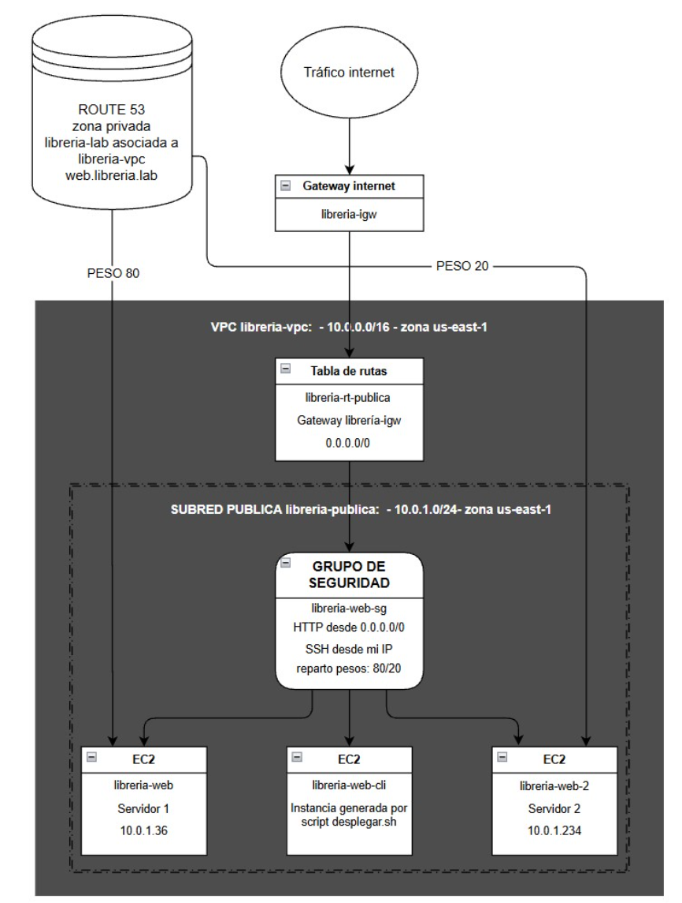

Resumen de los componentes:

| Recurso             | Nombre                | Configuración                                                |
| ------------------- | --------------------- | ------------------------------------------------------------ |
| VPC                 | `libreria-vpc`        | CIDR `10.0.0.0/16`                                           |
| Subred pública      | `libreria-publica`    | CIDR `10.0.1.0/24`, zona `us-east-1a`, IP pública automática |
| Gateway de internet | `libreria-igw`        | Asociada a `libreria-vpc`                                    |
| Tabla de rutas      | `libreria-rt-publica` | `0.0.0.0/0` → `libreria-igw`, asociada a `libreria-publica`  |
| Grupo de seguridad  | `libreria-web-sg`     | HTTP 80 desde `0.0.0.0/0`; SSH 22 solo desde mi IP           |
| Instancia EC2       | `libreria-web`        | Amazon Linux 2023, `t3.micro`, clave `vockey`                |

---

## 2. Nivel básico

### B1. La red

- `libreria-vpc`:
  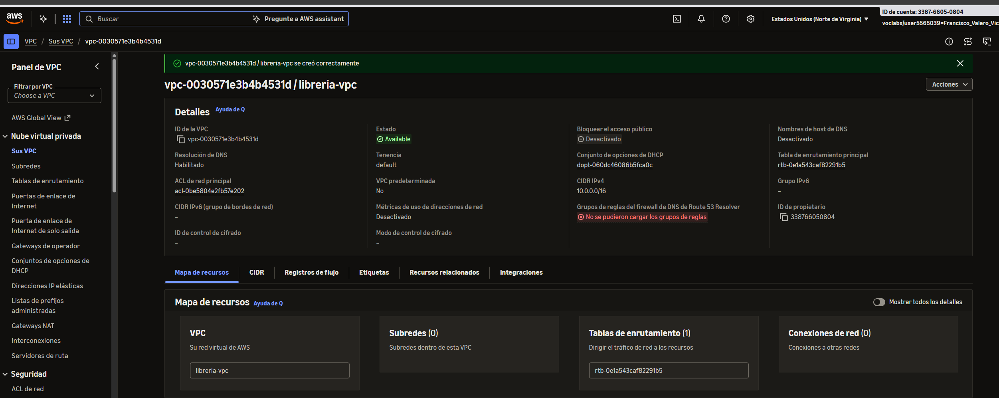

- `libreria-publica`:
  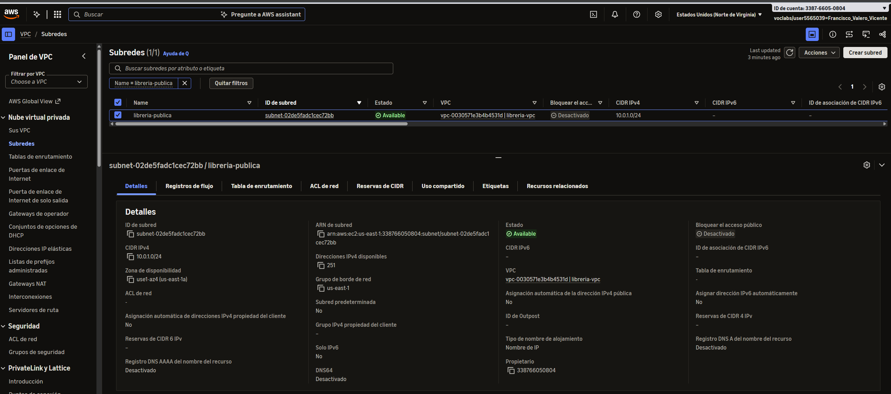

- `libreria-igw`:
  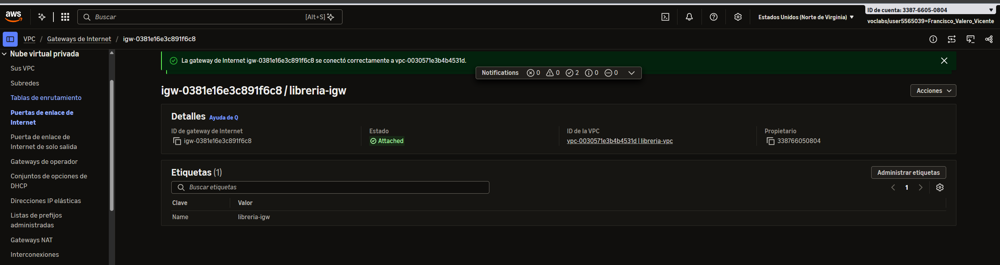

- `libreria-rt-publica` (rutas y asociación de subred):
  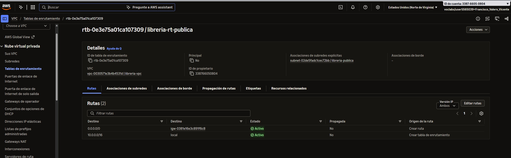
  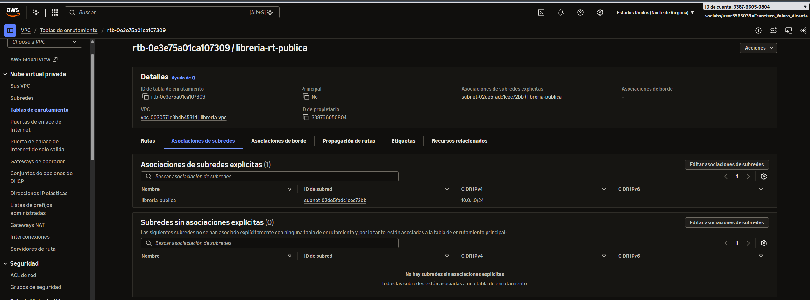

**¿Por qué la subred es pública?**
Porque su tabla de rutas tiene una ruta `0.0.0.0/0` hacia el Internet Gateway, lo que permite el tráfico entrante y saliente con internet, y porque las instancias que se lanzan en ella reciben una IP pública automáticamente.

### B2. La seguridad

- GRUPO DE SEGURIDAD `libreria-web-sg`:
  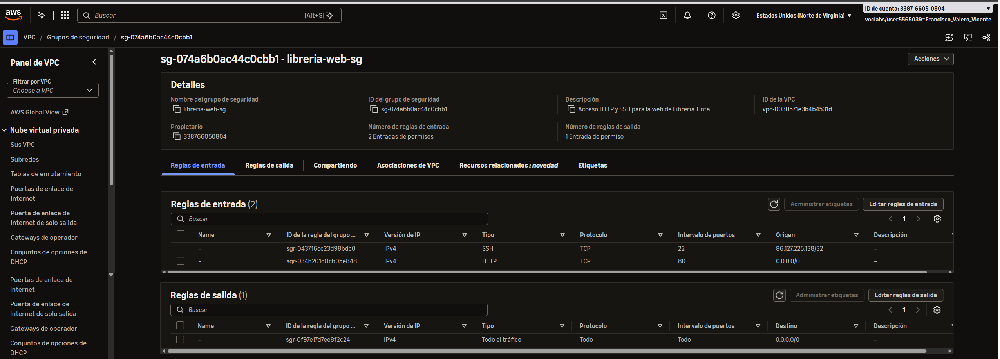

| Tipo | Puerto | Origen      | Motivo                                     |
| ---- | ------ | ----------- | ------------------------------------------ |
| HTTP | 80     | `0.0.0.0/0` | Cualquiera debe poder ver la web           |
| SSH  | 22     | Mi IP       | Solo yo debo poder administrar el servidor |

**¿Por qué el SSH solo se abre a mi IP?**
SSH da acceso de administración al servidor. Si estuviera abierto a todo internet, cualquiera podría intentar entrar por fuerza bruta. Limitarlo a mi IP reduce la superficie de ataque al mínimo necesario.

### B3. El servidor web

- INSTANCIA `libreria-web` (detalles, red, grupo de seguridad y etiquetas `Proyecto = P1` y `Alumno`):
  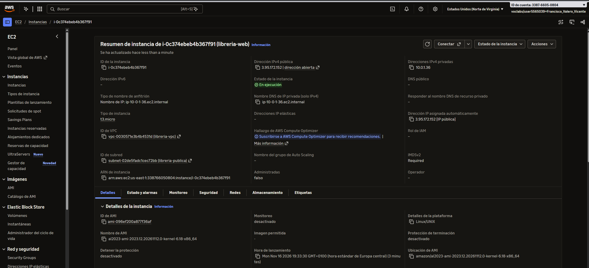

El script de arranque (user data) está en [`scripts/user-data1.sh`](scripts/user-data1.sh). Instala nginx, lo activa y sustituye la página de inicio por la de la librería.

- Web lanzada:
  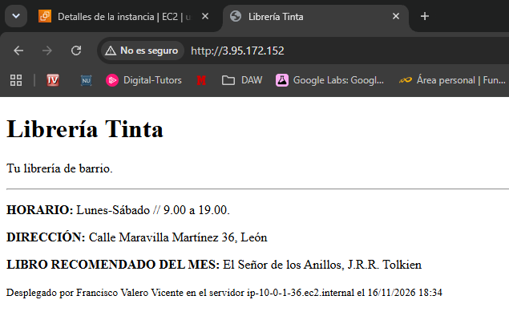

- Conexión SSH
  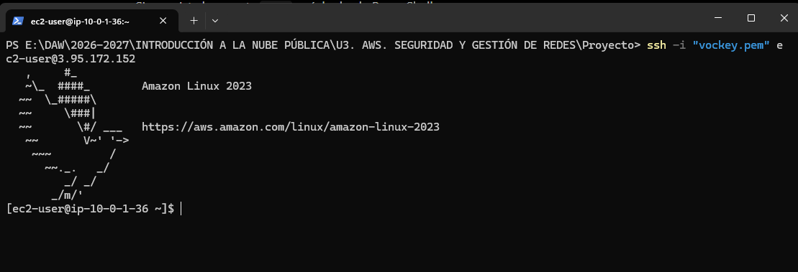

### B4. Presupuesto

- **Enlace compartido de la estimación:** [Ver estimación en AWS Pricing Calculator](https://calculator.aws/#/estimate?id=40b2e87dcb884eca92dc343452b6ccfd81fe573f)
- **Coste mensual estimado (1 servidor 24/7 en us-east-1):** 8,08 USD/mes; 96,96 USD/año

- Presupuesto:
  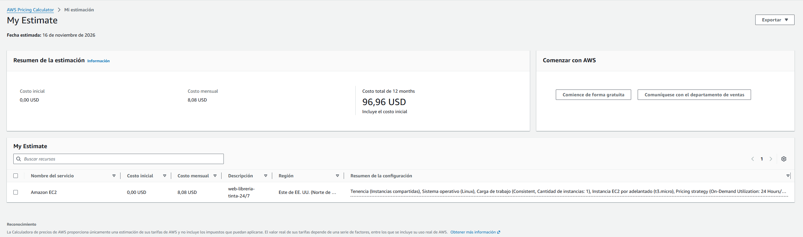

**Cómo se podría abaratar:** apagando la instancia cuando no se usa (por ejemplo, fuera del horario de apertura) o comprometiéndose a un uso continuado con una Savings Plan o instancia reservada, que reduce el precio por hora frente a On-Demand.

---

## 3. Nivel medio

### M1. DNS ponderado con Route 53

- Segunda instancia: `libreria-web-2`, misma VPC, subred y grupo de seguridad. Su user data está en [`scripts/user-data2.sh`](scripts/user-data2.sh) y muestra un texto distinto para identificarla como servidor 2.
- IP privada servidor 1: `10.0.1.36`
- IP privada servidor 2: `10.0.1.234`
- Opciones DNS de `libreria-vpc` (resolución de DNS y nombres de host DNS) activadas.
- Zona privada de Route 53 `libreria.lab`, asociada a `libreria-vpc`.

| Nombre             | Tipo | Política  | Peso | ID del registro | Valor        |
| ------------------ | ---- | --------- | ---- | --------------- | ------------ |
| `web.libreria.lab` | A    | Ponderada | 80   | `V1`            | `10.0.1.36`  |
| `web.libreria.lab` | A    | Ponderada | 20   | `V2`            | `10.0.1.234` |

- Zona Privada y registros:
  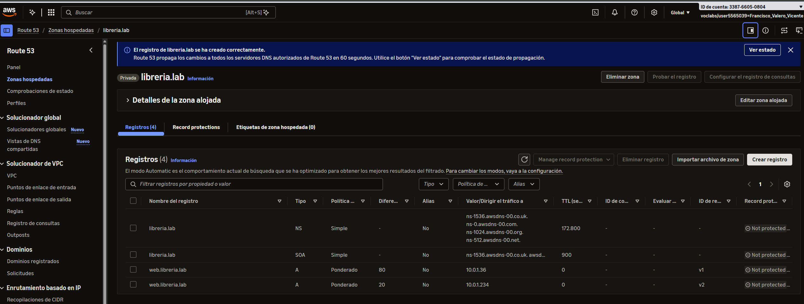

**Comprobación desde una instancia de la VPC** (por SSH):

```bash
dig web.libreria.lab +short
for i in $(seq 1 30); do curl -s http://web.libreria.lab | grep -iE "servidor 2|ip-10-0-1-36"; done
```

- Peticiones CURL:
  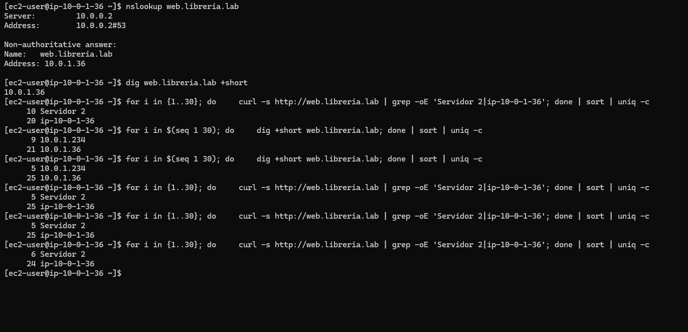

- 2 webs lanzadas (**Aclaración**: Las direcciones IP públicas no coinciden con las de las capturas de las instancias porque en la primera captura no se llegaban a ver las direcciones. Tuve que volver a lanzar el LAB y generó unas IP nuevas)
  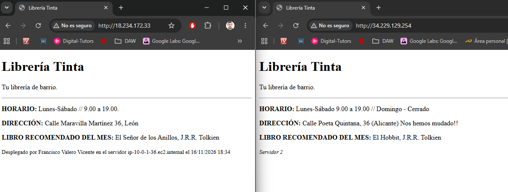

Observación: el reparto 80/20 es una ponderación probabilística, por lo que en 30 peticiones no se obtienen exactamente 24 y 6 respuestas. Se hicieron varias llamadas y se comprobó que el número de peticiones a cada dirección variaba, pero casi siempre en una relación cercana a la distribución de pesos elegida.

### M2. Presupuesto actualizado

- **Enlace compartido de la estimación (2 servidores + DNS):** [Ver estimación en AWS Pricing Calculator](https://calculator.aws/#/estimate?id=6a49a8365237d3501e59824af82ef6014197ad7b)
- **Coste mensual estimado:** 15,42 USD/mes; 185,04 USD/año

- Presupuesto:
  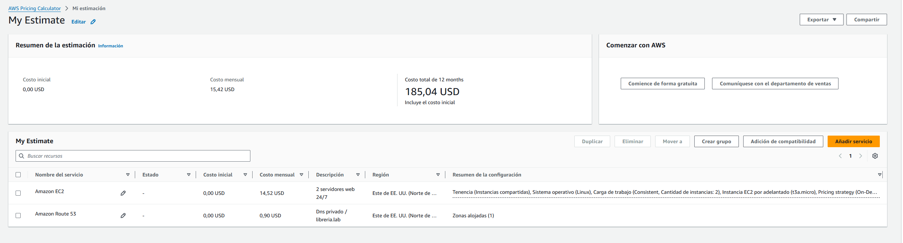

---

## 4. Nivel avanzado

El script [`scripts/desplegar.sh`](scripts/desplegar.sh) replica desde la AWS CLI los pasos B2 y B3: crea el grupo de seguridad, abre los puertos 80 y 22, lanza la instancia con el user data, espera a que esté en `running` y muestra la URL de la web. La red (B1) se reutiliza.

Se ejecutó desde AWS CloudShell. `user-data1.sh` se subió a la carpeta predeterminada y `desplegar.sh` se creó directamente en la terminal con `nano desplegar.sh`, pegando allí el código. Ambos ficheros estaban en la misma carpeta. El script también se puede consultar en `scripts/`.

**Comprobación de que funciona:**

- Salida del script:
  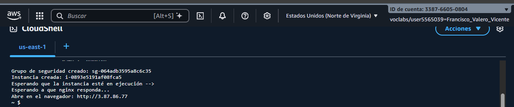

- Web desplegada por el script:
  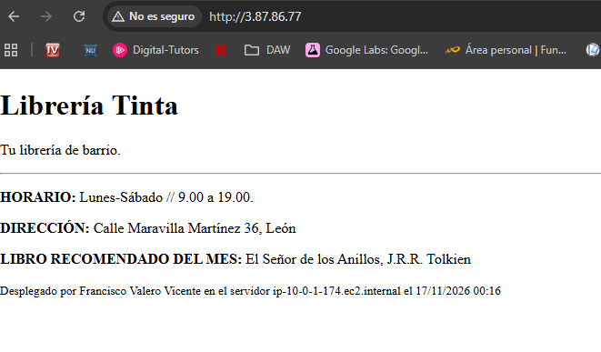

---

## 5. Uso de IA

**1. Herramienta utilizada:** Claude (Anthropic).

**2. Prompts que me resultaron útiles:**

- «Dame el comando para permitir HTTP (80) desde cualquier origen y el comando para permitir SSH (22) solo desde MI_IP» (AWS CLI, en el script `desplegar.sh`).
- «Dame los comandos para esperar a que la instancia esté en estado running y obtener su IP pública y guardarla en la variable IP».
- «¿Cómo ejecuto el fichero en CloudShell? ¿Tengo que pegar todo el contenido en la terminal?»

**3. Error o propuesta incorrecta de la IA detectada:**

Durante la generación de las partes a completar del script, en una instrucción puse un carácter que hacía que el script fallara y devolviera el error `syntax error near unexpected token` en la línea 54. Al pasarle a la IA ese texto de error, Claude apuntó primero a las líneas anteriores (barra `\` mal puesta, `$(` sin cerrar…), pero la causa real estaba en el propio `echo`, cuyo texto llevaba paréntesis. Lo comprobé ejecutando `bash -n desplegar.sh` y revisando esa línea, y lo corregí poniendo el texto entre comillas.

Nota: no he pegado mis credenciales de AWS en ninguna herramienta de IA ni las he subido al repositorio.

---

## 6. Estructura del repositorio

```
proyecto1/
├── README.md
├── img/       # capturas de pantalla
└── scripts/
    ├── user-data1.sh
    ├── user-data2.sh   # nivel medio
    └── desplegar.sh    # nivel avanzado
```
